# TP01 - Mise en place du protocole SSH

## Informations générales

- Matière : Services Réseaux Avancés
- Niveau : L3 GLSI A
- Année universitaire : 2026-2027

## Membres du groupe

- Étudiant 1 :Abdoulaye SARR
- Étudiant 2 :

### Objectif : Comprendre comment utiliser SSH pour sécuriser l'accès à une machine distante.

## 1. Installation et configuration SSH
-  Installation

  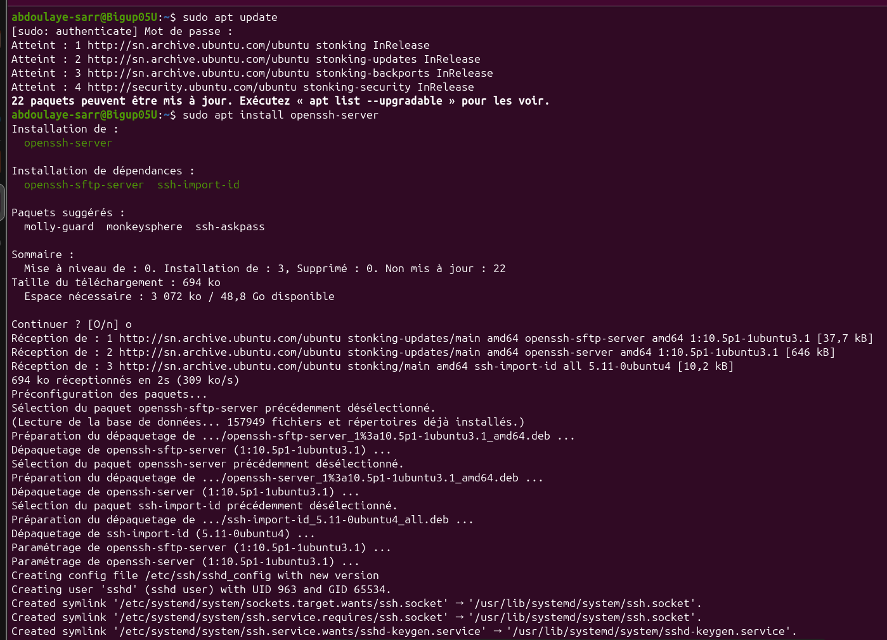
  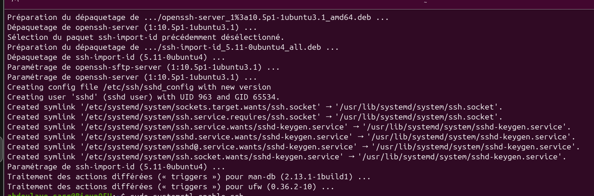

-  Configuration
  
  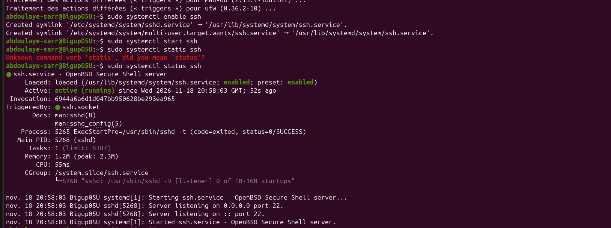

-  Vérification du port 22

  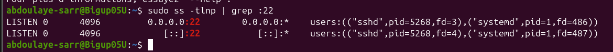
  
## 2. Connexion distante

-  Connexion avec le client Windows au serveur ubuntu

  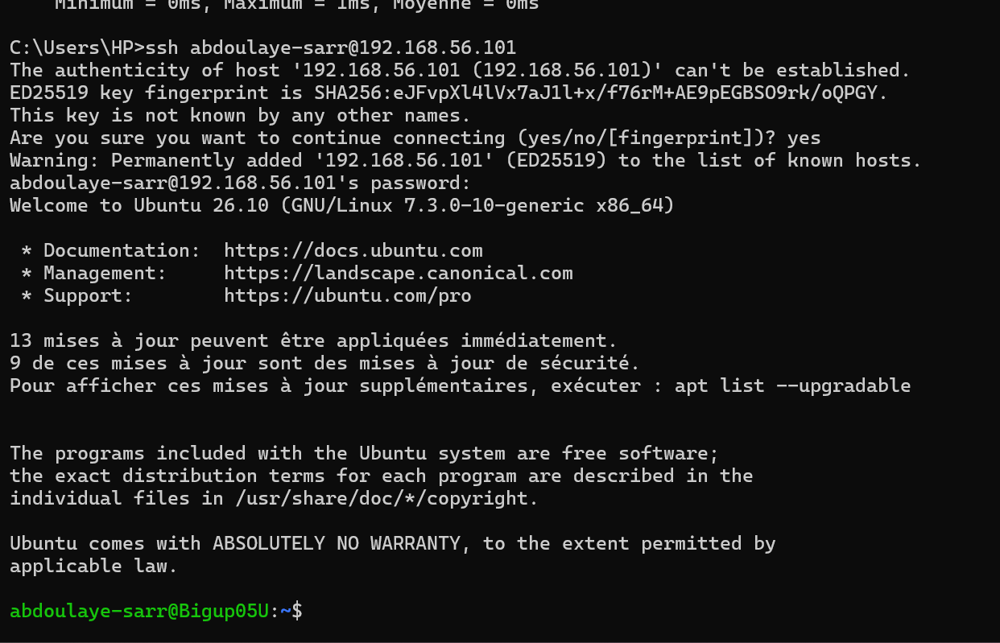

## 3. Connexion distante par clés SSH

-  Génération de la clé publioque

  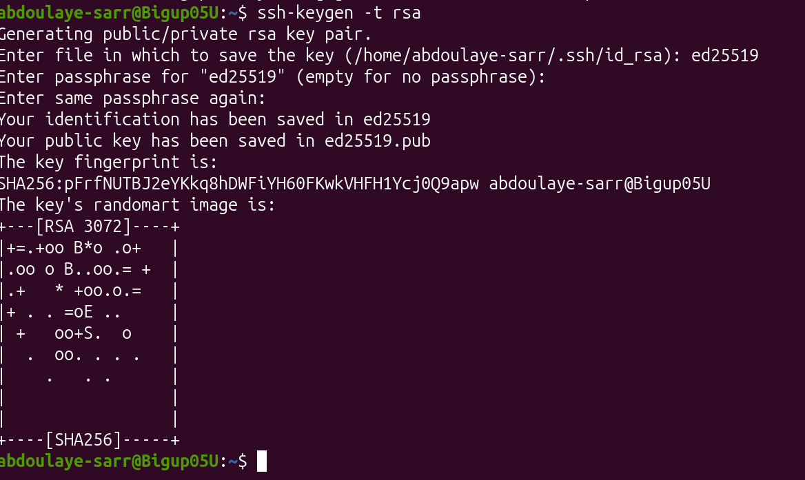

-  Vérification du fichier de la clé

  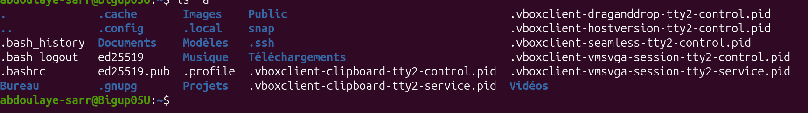

-  Partage de la clé avec debian dans /home

  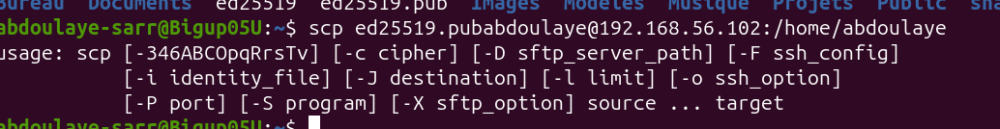  
  
## 4.1 Tunnel ssh en ligne de commande

-  Connexion au serveur avec debian

  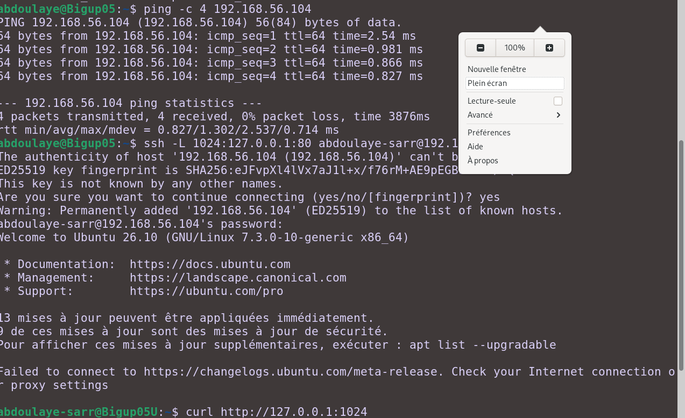

-  Résultat du curl htp://127.0.0.1:1024

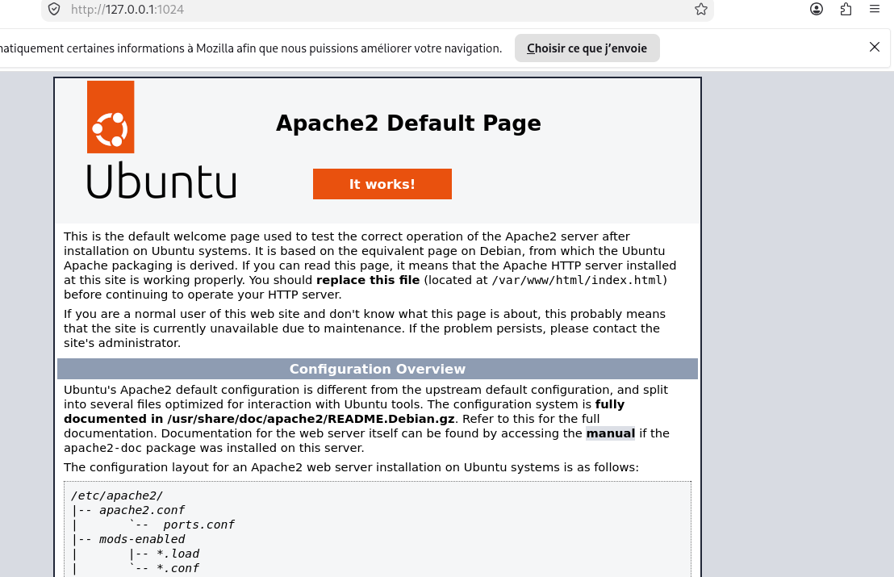

### 4.2 MariaDB

-  Installation de Mariadb

  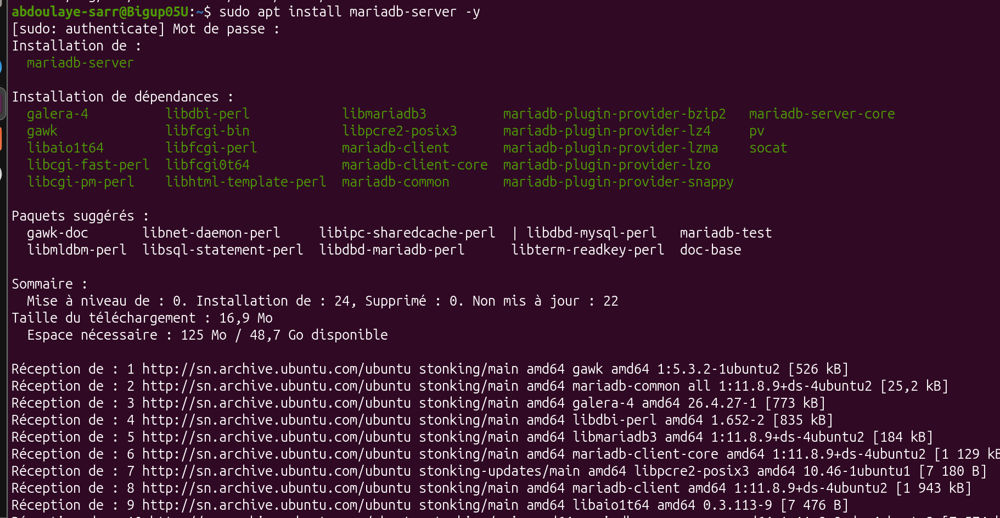

-  Configuration de Mariadb

  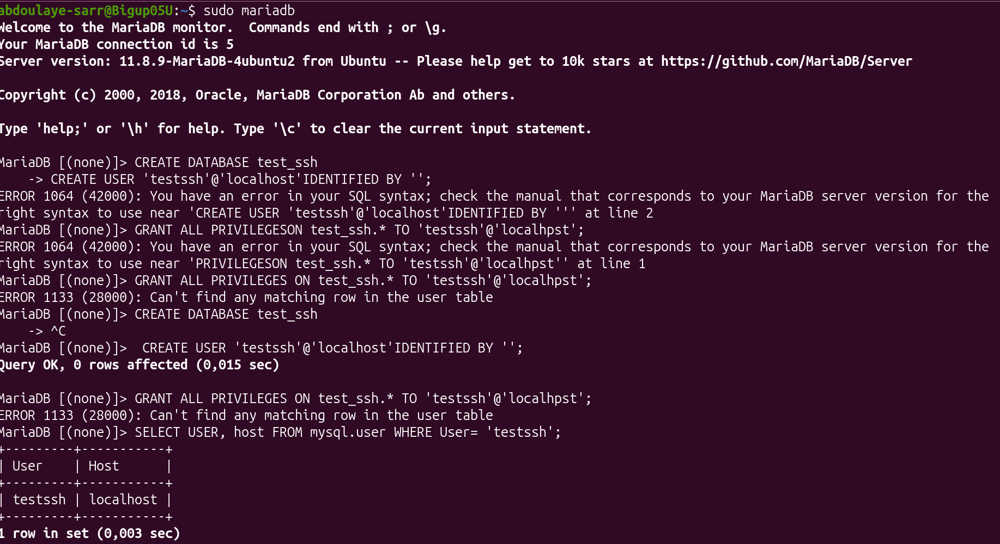

## Conclusion
Ce travail nous a permis de comprendre la connexion à distance avec SSH, avec ou sans clé, et avec tunnel SSH en ligne de  coimmande
