# TP02 - Configuration et Utilisation de Remote Desktop Protocol (RDP)

## Informations générales

- Matière : Services Réseaux Avancés
- Niveau : L3 GLSI A
- Année universitaire : 2026-2027

## Membres du groupe

- Étudiant 1 :Abdoulaye SARR
- Étudiant 2 :

### Objectif : Configurer et utiliser RDP pour accéder à un ordinateur Windows à distance de
manière sécurisée.

##  Partie 1 : Activer le Bureau à Distance sur le Serveur Windows
### 1. Vérification de la Version de Windows
-  Vérification des informations du système
  Dans Windows > paramètre > Système > informations système

  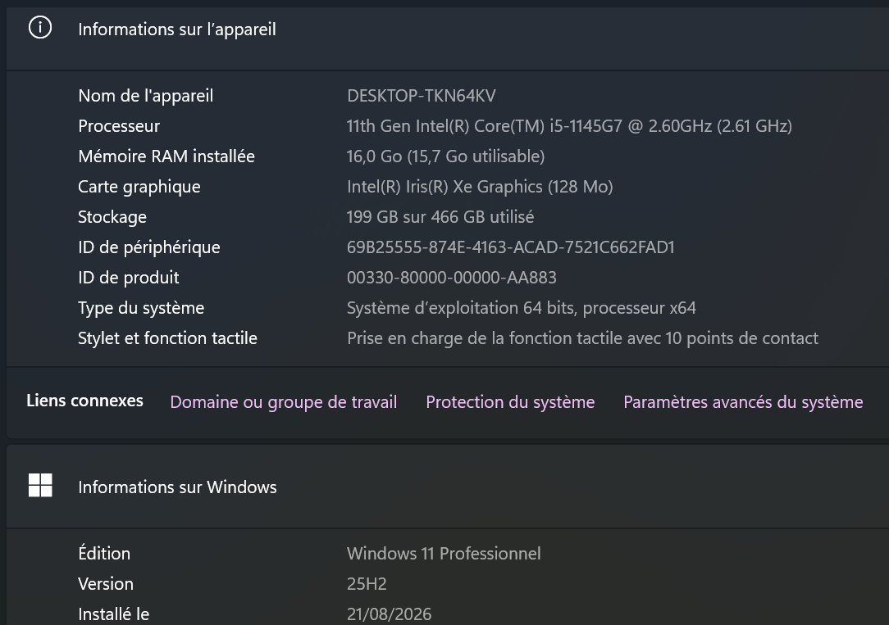

### 2. Activation du bureau à distance

  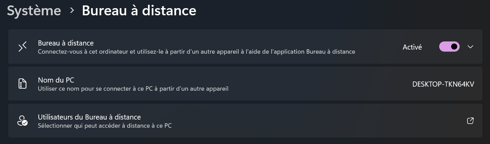

### 3. Configurer l'Accès des Utilisateurs :
Ici mon utilisateur principal hp à déjà accès au bureau à distance

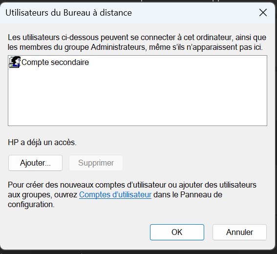

### 4. Vérification des paramètre du Pare-Feu

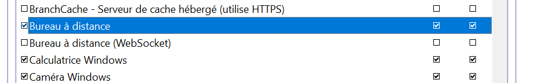

##  Partie 2 : Connexion au Serveur RDP depuis un Client Windows

##  Partie 3 : Connexion au Serveur RDP depuis un Client Linux

### 1. Installer un Client RDP (Remmina ou FreeRDP) 
-  Installation de remmina : moi vue que je l'avais déjà installé ça donne ça

  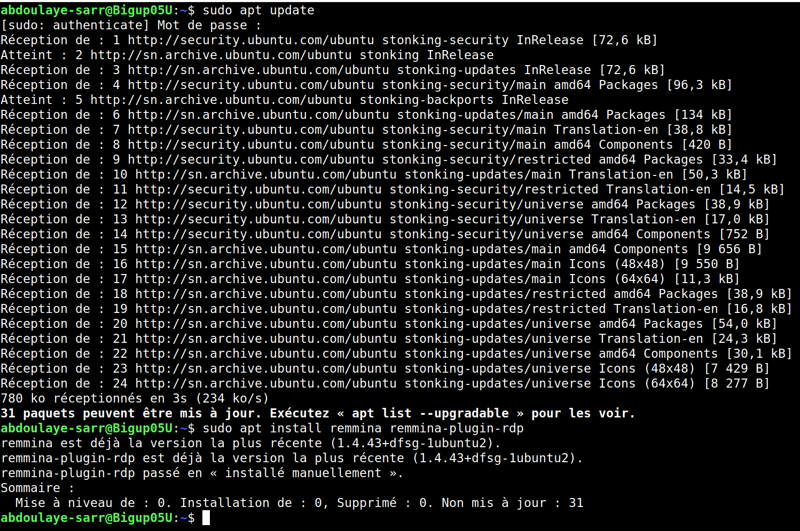

### 2. Lancer Remmina et Configurer la Connexion 

-  Lancement de rémmina

  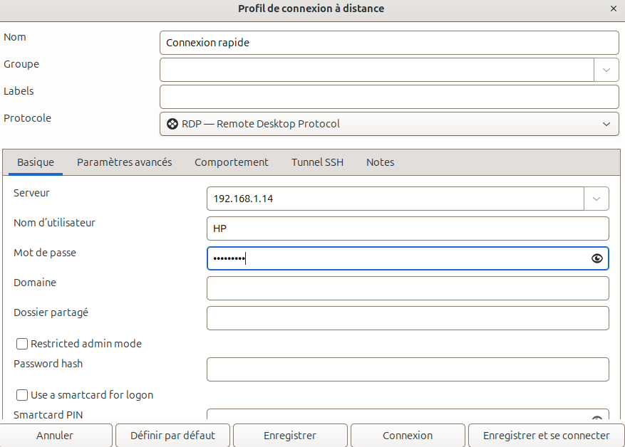
  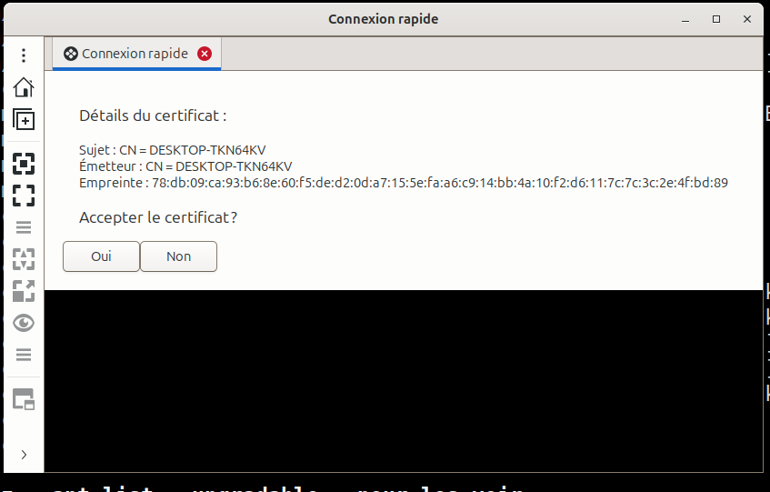

### 3. test de la connexion
validation de la connexion

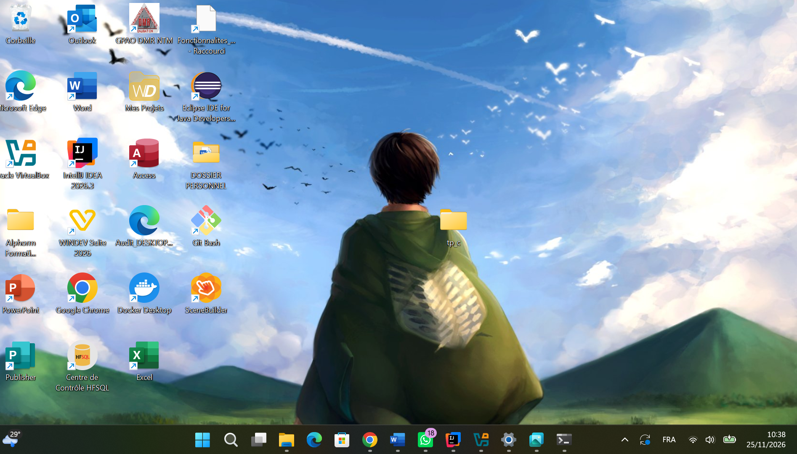

##  Partie 4 : Activation du service RDP sous virtualbox pour accès à une machine
-  VirtualBox peut être configuré pour offrir un accès distant aux machines virtuelles, via le
protocole RDP (Bureau à distance). Lancez votre VitualBox.

  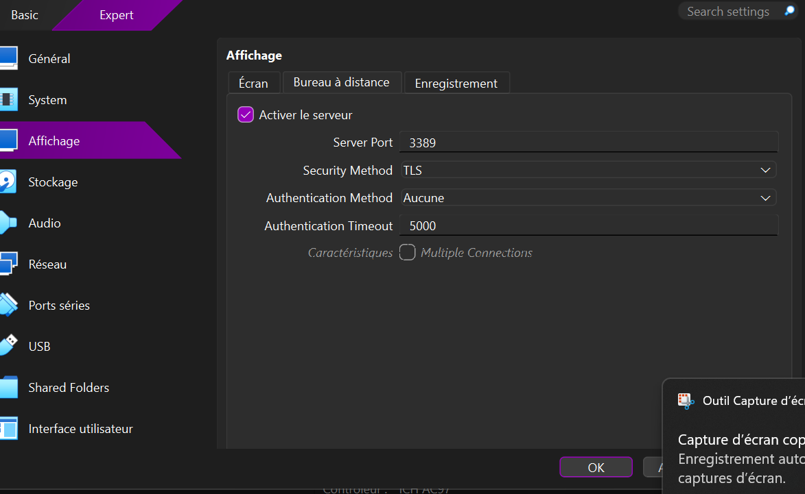

-  Test de bon fonctionnement Comme client, nous allons utiliser l’outil Bureau à distance de
Windows

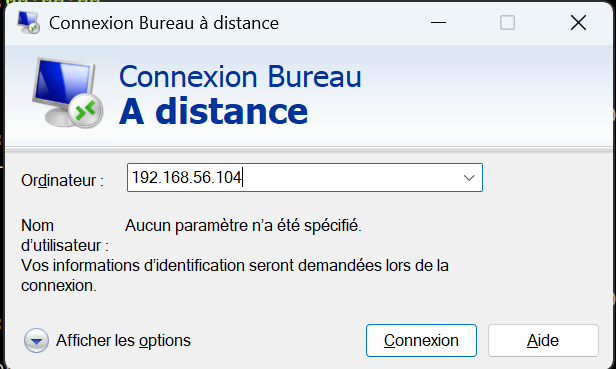

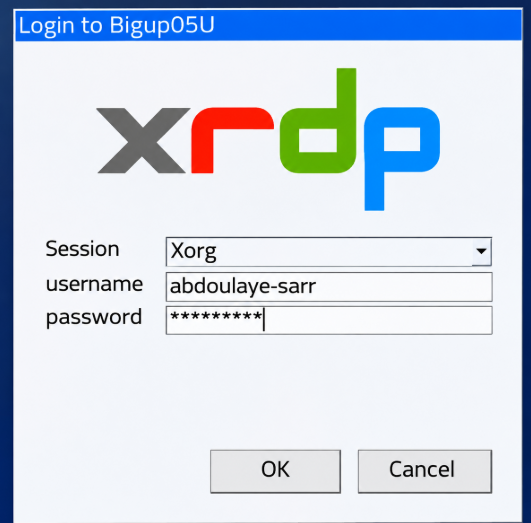

### Conclusion
ce tp nous a donc permis comprendre l'accès bureau à distance et les aspects essentiels de RDP

